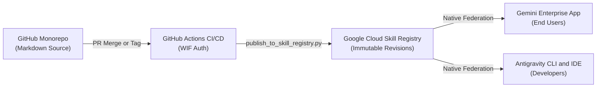

# Deployment, governance, and operations guide

This guide defines the operational standards, access requirements, versioning strategy, and deployment methodologies for managing and publishing skills to a managed **Gemini Enterprise** application.

---

## 1. System and access requirements

Before you deploy or manage skills in an enterprise or government environment, verify that your environment meets the following identity, software, and compliance requirements.

### Identity and IAM roles

Administrators and CI/CD service accounts require the following permissions to manage and publish skills:

* **Google Cloud console and Discovery Engine**:
  * `roles/discoveryengine.admin`: Allows administrators to create, configure, and register application extensions or agents at the organization level.
  * `roles/discoveryengine.editor`: Allows administrators or service accounts to update skill metadata, manage collections, and create skill revisions.
  * `roles/iam.workloadIdentityUser`: Allows GitHub Actions workflows to authenticate with Google Cloud by using Workload Identity Federation (WIF).
* **Google Workspace Admin console**:
  * **Gemini Enterprise Administrator**: Allows administrators to approve and distribute skills across organizational units (OUs) or Google Groups.
* **GitHub repository permissions**:
  * **Maintainer** or **Admin**: Allows maintainers to merge pull requests into `main` and push release tags.
  * **Branch protection rules**: Configure the `main` branch to require passing status checks (`validate-skills.yaml`) and approval from designated [`.github/CODEOWNERS`](.github/CODEOWNERS).

### Local software requirements

Contributors who author, validate, or publish skills from a local workstation must install the following tools:

* Python 3.10 or later
* Git 2.30 or later
* Google Cloud CLI (`gcloud`) 450.0.0 or later

### Compliance and data residency

When deploying skills in government or regulated environments, observe the following compliance boundaries:

* **Government and FedRAMP boundaries**: All skills published from this catalog operate within your agency's Gemini Enterprise tenant. Prompts, documents, and reference files remain inside your security perimeter and never train public foundational models.
* **VPC Service Controls**: If your environment enforces a restricted VPC Service Controls perimeter, include all reference guidance directly inside the skill package. Do not rely on external web grounding as a hard dependency.

---

## 2. Skill architecture and best practices

To maintain low latency and prevent prompt bloating, all skills in this catalog must follow four core architectural patterns:

### Adhere to the 10-file limit

Gemini Enterprise enforces a hard limit of **10 files per skill package**:

* Include `SKILL.md` at the root of the skill directory, plus a maximum of nine supporting files in `references/`.
* The validation script (`scripts/validate_skills.py`) and GitHub Actions CI reject packages that contain more than 10 files.

### Use progressive disclosure

To minimize Time-To-First-Token (TTFT) latency and reduce token consumption, organize content into two levels:

* **Level 1 (`SKILL.md`)**: Place the 10 golden rules, core principles, and review checklist in the root `SKILL.md` file. This structure enables Gemini Enterprise to answer approximately 80% of routine requests immediately without retrieving secondary files.
* **Level 2 (`references/`)**: Place detailed reference materials (such as API formatting specifications or comprehensive word lists) in the `references/` directory. Gemini Enterprise retrieves these files dynamically only when a task requires specialized rules.

### Define explicit scope boundaries

Every skill's YAML frontmatter must include explicit positive and negative scope boundaries in its `description` field:

* **`USE FOR:`**: List the specific target domains (for example, software developer guides, API references, and CLI manuals).
* **`DO NOT USE FOR:`**: List out-of-scope tasks (for example, executive memos, policy letters, press releases, and legal contracts).

Because Gemini Enterprise activates skills dynamically based on semantic similarity, explicit negative boundaries prevent the model from applying technical documentation rules to general business correspondence.

### Include the agency precedence clause

Every skill must include the following precedence notice in `SKILL.md`:

> *"If an agency-specific policy, statutory requirement, or GPO guideline conflicts with a rule in this guide, the agency-specific requirement takes precedence."*

---

## 3. Versioning strategy

This repository uses **Semantic Versioning (SemVer 2.0.0)** to track changes to skills.

### Version format (`MAJOR.MINOR.PATCH`)

Increment version numbers according to the following criteria:

* **`MAJOR` (breaking changes)**:
  * Reorganizing the structure of `SKILL.md`.
  * Changing core rules in a way that alters how Gemini Enterprise audits or rewrites documents.
  * Removing or renaming reference files.
* **`MINOR` (additive changes)**:
  * Adding new reference guides in `references/` (while remaining within the 10-file limit).
  * Expanding word lists, examples, or audit checklists.
  * Adding new validation or publishing features.
* **`PATCH` (fixes and refinements)**:
  * Fixing typographical errors, broken links, or formatting issues without changing the underlying rules.

### Monorepo tagging convention

Because this repository stores multiple skills in a single monorepo, tag individual skill releases by using the `<skill-name>@v<MAJOR>.<MINOR>.<PATCH>` format:

```bash
git tag -a <SKILL_NAME>@v<MAJOR>.<MINOR>.<PATCH> -m "<RELEASE_DESCRIPTION>"
git push origin <SKILL_NAME>@v<MAJOR>.<MINOR>.<PATCH>
```

For example, to tag version `1.1.0` of the documentation style skill, run the following commands:

```bash
git tag -a google-developer-documentation-style@v1.1.0 -m "Add API reference documentation guide"
git push origin google-developer-documentation-style@v1.1.0
```

---

## 4. Deployment methodologies

This repository separates source control from runtime distribution:

* **GitHub (source of truth)**: Stores pure Markdown source files, enforces automated validation, and manages peer review through `CODEOWNERS`. Binary `.zip` files are not tracked in Git.
* **Google Cloud Skill Registry (runtime catalog)**: Stores published skills (`projects/<PROJECT_ID>/locations/<LOCATION>/skills/<SKILL_NAME>`), maintains immutable **Skill Revisions**, tracks Cloud Audit Logs, and federates skills directly into Gemini Enterprise applications.



Depending on your agency's security posture, deploy skills by using either **automated CI/CD publishing** or **admin-governed manual upload**.

---

### Methodology A: Automated publishing to the Google Cloud Skill Registry

For environments that support automated cloud deployments, use `scripts/publish_to_skill_registry.py` or GitHub Actions to publish skills directly to the Google Cloud Skill Registry.

#### Publish from a local workstation

To publish a skill from your local machine to the Google Cloud Skill Registry, complete the following steps:

1. Authenticate with Google Cloud:
   ```bash
   gcloud auth login
   ```
2. Run the publishing script:
   ```bash
   python3 scripts/publish_to_skill_registry.py \
     --project <PROJECT_ID> \
     --location global \
     --skill google-developer-documentation-style
   ```
   The script validates the skill, packages the files in memory, sends the payload to the Discovery Engine API (`discoveryengine.googleapis.com/v1beta1`), and outputs the new immutable skill revision ID.

#### Publish through GitHub Actions CI/CD

To automate publishing whenever a maintainer pushes a version tag, configure a GitHub Actions workflow with Workload Identity Federation:

```yaml
name: Publish to Google Cloud Skill Registry

on:
  push:
    tags:
      - "*@v*"

jobs:
  deploy:
    runs-on: ubuntu-latest
    permissions:
      contents: read
      id-token: write

    steps:
      - name: Checkout repository
        uses: actions/checkout@v4

      - name: Authenticate to Google Cloud
        uses: google-github-actions/auth@v2
        with:
          workload_identity_provider: "projects/<PROJECT_NUMBER>/locations/global/workloadIdentityPools/<POOL_ID>/providers/<PROVIDER_ID>"
          service_account: "<DEPLOYER_SA>@<PROJECT_ID>.iam.gserviceaccount.com"

      - name: Set up Python
        uses: actions/setup-python@v5
        with:
          python-version: "3.11"

      - name: Validate and publish skills
        run: |
          python3 scripts/validate_skills.py
          python3 scripts/publish_to_skill_registry.py \
            --project ${{ secrets.GCP_PROJECT_ID }} \
            --location global
```

---

### Methodology B: Admin-governed manual upload

For air-gapped environments or agencies that require a manual administrative gate before production changes, complete the following steps:

1. Generate the `.zip` archive locally (or download it from the **GitHub Releases** page):
   ```bash
   python3 scripts/publish_to_skill_registry.py --skill google-developer-documentation-style --export-zip dist
   ```
   The script writes `dist/google-developer-documentation-style.zip`.
2. Open the **Gemini Enterprise** web console with an administrator account.
3. In the left navigation menu, click **Skills**.
4. Click **Create Skill** (or **Add Skill**), select **Upload Skill**, and select the `.zip` archive.
5. In the **Sharing and Visibility** section, select **Share with Groups** and assign the skill to a pilot group (such as the technical writing leads).
6. Verify the skill in production chat sessions for 48 hours to confirm that no unintended semantic triggers occur.
7. Update the sharing settings to **Share with Organization**.

---

## 5. Rollback and incident management

If a skill update causes unexpected behavior, use one of the following rollback procedures.

### Disable a skill immediately

To stop a skill from executing across active chat sessions in under two minutes, complete the following steps:

1. In the **Gemini Enterprise** console, click **Skills**.
2. Select the affected skill.
3. Toggle the skill status from **Enabled** to **Disabled** (or change visibility from **Share with Organization** to **Private**). The platform halts execution of the skill across all user sessions immediately.

### Restore a previous skill revision

To roll back to a previous version of a skill, complete the following steps:

1. Check out the previous stable Git tag in your local repository (for example, `google-developer-documentation-style@v1.0.0`):
   ```bash
   git checkout google-developer-documentation-style@v1.0.0
   ```
2. Publish the prior version to the Google Cloud Skill Registry:
   ```bash
   python3 scripts/publish_to_skill_registry.py \
     --project <PROJECT_ID> \
     --location global \
     --skill google-developer-documentation-style
   ```
   Alternatively, download the prior `.zip` archive from the **GitHub Releases** page and upload it through the **Replace Package** option in the web console.
3. Revert the offending commit on the `main` branch and open a tracking issue.

---

## 6. Audit logging and monitoring

Gemini Enterprise records administrative and usage events in Google Cloud **Logs Explorer**:

* **Admin activity logs**: Track skill creation, revision updates, sharing changes, and deletions under the `discoveryengine.googleapis.com` service name.
* **Data access logs**: Record when users invoke skills in chat sessions.
* **Cloud Monitoring metrics**: Track skill invocation counts, latency, and error rates across your organization.
