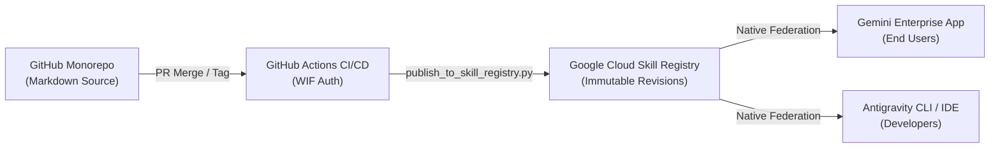

# Deployment, Governance, and Operations Guide

This guide establishes the operational standards, requirements, versioning strategy, and deployment methodologies for managing and deploying skills from this repository to a managed **Gemini Enterprise** application.

---

## 1. System and Access Requirements

Before deploying or managing skills in an enterprise or government environment, ensure the following identity, software, and compliance prerequisites are met.

### Identity and IAM Roles
To manage and publish skills in Gemini Enterprise, administrators and CI/CD service accounts require the following permissions:

* **Google Cloud Console / Discovery Engine**:
  * `roles/discoveryengine.admin`: Required to create, configure, and register app extensions or agents at the organization level.
  * `roles/discoveryengine.editor`: Required to update skill metadata, manage collections, and register reasoning engines.
  * `roles/iam.workloadIdentityUser`: Required for GitHub Actions automated deployments using Workload Identity Federation (WIF).
* **Google Workspace Admin Console**:
  * **Gemini Enterprise Administrator**: Required to approve and distribute skills across organizational units (OUs) or Google Workspace groups.
* **GitHub Repository Permissions**:
  * **Maintainer / Admin**: Required to merge pull requests affecting production skills and cut release tags.
  * **Protected Branches**: The `main` branch must enforce status checks (`validate-skills.yaml`) and require review from designated `CODEOWNERS`.

### Local Software Requirements
For contributors authoring, testing, or packaging skills:
* **Python**: Version 3.10 or higher.
* **Git**: Version 2.30 or higher.
* **Google Cloud SDK (`gcloud`)**: Version 450.0.0 or higher (for cloud registry management).

### Compliance and Data Residency
* **Government and FedRAMP Environments**: All skills deployed from this catalog operate strictly within your agency's Gemini Enterprise tenant. Prompts, documents, and reference materials remain within your enterprise security perimeter and are never used to train public foundational models.
* **VPC Service Controls**: If your deployment operates inside a restricted VPC Service Control perimeter, ensure all reference files are self-contained within the skill package. External web grounding must not be relied upon as a hard dependency.

---

## 2. Skill Architecture and Best Practices

To maintain performance, prevent latency spikes, and avoid prompt bloating, all skills in this catalog must adhere to the following architectural rules:

### A. The 10-File Ceiling (Hard Constraint)
Gemini Enterprise enforces a hard limit of **10 files per skill ZIP archive**.
* Every skill must consist of `SKILL.md` at the root, plus a maximum of **9 supporting files** in `references/` or helper scripts.
* Packages containing 11 or more files will be rejected by `scripts/validate_skills.py` and GitHub Actions CI.

### B. Progressive Disclosure Pattern
To keep chat responses fast and reduce token consumption:
* **`SKILL.md` (Level 1)**: Must contain the core principles, 10 Golden Rules, and an editorial checklist. This allows Gemini to answer approximately 80% of routine user queries immediately without reading secondary files.
* **`references/` (Level 2)**: Houses granular reference documents (such as deep API formatting specs or comprehensive word lists). Gemini retrieves these reference files dynamically only when a complex or ambiguous prompt requires deeper context.

### C. Explicit Scope Boundaries
Every skill's YAML frontmatter must include unambiguous boundary markers in its `description`:
* **`USE FOR:`**: Explicitly enumerate target domains (for example, software documentation, API references, CLI manuals).
* **`DO NOT USE FOR:`**: Explicitly declare out-of-scope tasks (for example, executive correspondence, legal policy, press releases).
* *Why this matters*: Gemini Enterprise dynamically activates skills based on semantic matching. Explicit negative boundaries prevent the model from inadvertently applying technical rules to general business correspondence.

### D. The Precedence Clause
All agency skills must include an embedded precedence notice:
> *"If an agency-specific policy, statutory requirement, or GPO guideline conflicts with this guide, the agency-specific requirement takes precedence."*

---

## 3. Versioning Strategy

This repository enforces **Semantic Versioning (SemVer 2.0.0)** for all skills.

### Version Format: `MAJOR.MINOR.PATCH`

1. **`MAJOR` (Breaking Changes)**:
   * Structural reorganization of `SKILL.md`.
   * Altering core rule defaults that fundamentally change how Gemini rewrites or audits documents.
   * Removing or renaming reference files that existing workflows depend upon.
2. **`MINOR` (New Features & Additive Changes)**:
   * Adding new reference documents in `references/` (while staying within the 10-file ceiling).
   * Adding new terminology to word lists or expanding checklists.
   * Updating templates or packaging scripts.
3. **`PATCH` (Bug Fixes & Refinements)**:
   * Typo corrections, link updates, or clarifying existing wording without altering the underlying style rule.

### Multi-Skill Tagging Convention
Because this repository operates as a monorepo containing multiple skills, individual releases are versioned using skill-specific Git tags:

```bash
git tag -a <skill-name>@v<MAJOR>.<MINOR>.<PATCH> -m "Release description"
git push origin <skill-name>@v<MAJOR>.<MINOR>.<PATCH>
```

**Example:**
```bash
git tag -a google-developer-documentation-style@v1.1.0 -m "Add API reference documentation guide"
git push origin google-developer-documentation-style@v1.1.0
```

Pushing this tag automatically triggers the `.github/workflows/package-releases.yaml` workflow, which compiles the skill into a ZIP archive and attaches it to a new GitHub Release.

---

## 4. Deployment Methodologies

Depending on your agency's change-management policies and security posture, you can deploy skills using either an **Admin-Governed UI Workflow** or an **Automated CI/CD Pipeline**.

---

### Methodology A: Admin-Governed Manual Deployment (Recommended for Government)

### The Core Architectural Pattern: GitHub as Source, Skill Registry as Runtime

Leveraging the **Google Cloud Skill Registry** (`projects/{project}/locations/{location}/skills/*`) simplifies both the repository and the operational workflow:

* **GitHub is the Source of Truth:** Pure markdown source code, collaborative pull requests, automated validation, and `CODEOWNERS` peer review. **No binary ZIP files are stored in Git.**
* **Skill Registry is the Runtime Catalog:** Automatically provisions skills to your Gemini Enterprise Apps, manages immutable **Skill Revisions**, tracks audit logs, and handles permissions natively in Google Cloud.



---

### Methodology A: Automated Deployment to Skill Registry (Zero-Click CI/CD)

This is the recommended, simplified production workflow. A single script or GitHub Action publishes the skill directly into the Google Cloud Skill Registry.

#### Local / Script Execution:
```bash
# Authenticate with Google Cloud
gcloud auth login

# Publish skill directly to Google Cloud Skill Registry
python3 scripts/publish_to_skill_registry.py \
  --project <YOUR_GCP_PROJECT_ID> \
  --location global \
  --skill google-developer-documentation-style
```
The script packages the skill in memory, encodes the payload, sends it to `discoveryengine.googleapis.com/v1beta1`, and returns the newly minted immutable **Skill Revision ID**.

#### Automated GitHub Actions Pipeline (`.github/workflows/deploy-skill-registry.yaml`):

```yaml
name: Deploy Skills to Google Cloud Skill Registry

on:
  push:
    tags:
      - "*@v*"

jobs:
  deploy:
    runs-on: ubuntu-latest
    permissions:
      contents: read
      id-token: write

    steps:
      - name: Checkout Code
        uses: actions/checkout@v4

      - name: Authenticate to Google Cloud (Workload Identity Federation)
        uses: google-github-actions/auth@v2
        with:
          workload_identity_provider: "projects/123456789/locations/global/workloadIdentityPools/github-pool/providers/github-provider"
          service_account: "gemini-skills-deployer@my-gov-project.iam.gserviceaccount.com"

      - name: Set up Python
        uses: actions/setup-python@v5
        with:
          python-version: "3.11"

      - name: Publish Skills to Skill Registry
        run: |
          python3 scripts/publish_to_skill_registry.py \
            --project ${{ secrets.GCP_PROJECT_ID }} \
            --location global
```

---

### Methodology B: Admin-Governed Manual Deployment (Air-Gapped / Human Gate)

For environments where automated network ingress is prohibited and an administrator must perform a human-in-the-loop manual upload:

1. **Build Archive Locally or via Release Tag**:
   ```bash
   python3 scripts/package_skills.py --skill google-developer-documentation-style
   ```
2. **Access Gemini Enterprise Console**:
   * Open the Gemini Enterprise web console as an administrator.
   * Go to **Skills** > **Create Skill** (or **Add Skill**).
   * Upload the generated `.zip` from `dist/` (or from GitHub Releases).
3. **Staged Rollout (Canary / Pilot Group)**:
   * Share the skill initially with a **Pilot Group** (for example, the Technical Documentation Leads).
   * After verification in production chats, promote visibility to **Share with Organization**.

---

## 5. Rollback and Incident Management

If a skill update produces unexpected responses or conflicts with agency workflows, execute the following rollback procedure:

### Fast Rollback (Under 2 Minutes)
1. In the **Gemini Enterprise Console**, navigate to **Skills**.
2. Locate the impacted skill.
3. Toggle the status from **Enabled** to **Disabled** (or change visibility from *Organization* to *Private*).
4. This immediately halts skill execution across all active enterprise chat sessions without requiring a software deployment.

### Restoring a Previous Version
1. Download the previously known stable ZIP archive from GitHub Releases (for example, `v1.0.0` instead of `v1.1.0`).
2. In Gemini Enterprise, edit the existing skill and select **Replace / Re-upload Package**.
3. Upload the prior stable `.zip` file.
4. Save and re-enable visibility.
5. In Git, revert the commit on `main` and file a tracking issue detailing the unexpected behavior.

---

## 6. Audit Logging and Monitoring

Gemini Enterprise operations generate Cloud Audit Logs accessible via Google Cloud **Logs Explorer**:

* **Admin Activity**: Tracks skill creation, updates, sharing modifications, and deletions (`discoveryengine.googleapis.com`).
* **Data Access Logs**: Records when users invoke skills in conversation (without recording private prompt contents if sensitive logging is disabled).
* **Monitoring Metrics**: Use Google Cloud Monitoring to track skill invocation rates, response latency, and user satisfaction feedback.
